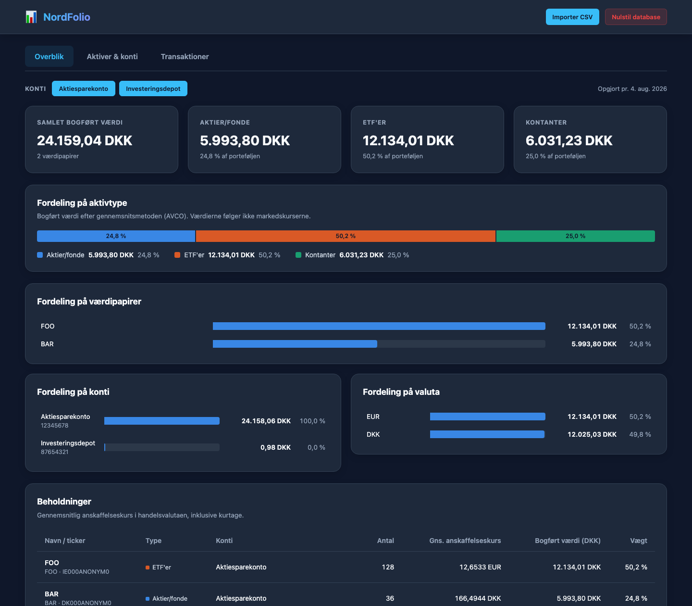

# NordFolio

> **OBS:** Dette er et “vibecodet” projekt! Alt brug er på eget ansvar..!

Et lokalt afviklet og privatlivsfokuseret værktøj til Nordnet-eksportfiler. NordFolio læser din transaktionshistorik, rekonstruerer dine beholdninger og kontantsaldi og viser, hvordan din portefølje er fordelt – 100 % lokalt på din egen maskine.

NordFolio bruger **ingen markedskurser**. Alle værdier er **bogført værdi**: hvad du har betalt for dine værdipapirer efter gennemsnitsmetoden (AVCO), plus dine kontanter. Det giver et præcist billede af, hvor din kapital er placeret, uden at du skal betale for adgang til realtidskurser.

Al din transaktionshistorik og dine indstillinger gemmes **lokalt i en enkelt JSON-fil (`db.json`)**. NordFolio laver ingen netværkskald ud af din maskine.

**OBS:** Værktøjet understøtter KUN dansksprogede eksportfiler. Af samme årsag findes NordFolio kun på dansk og viser værdier i DKK.

---

<p align="center">
  
</p>

---

## Funktioner

1. **Robust import af Nordnets CSV-eksport**
   - Detekterer automatisk UTF-16, UTF-8 og WINDOWS-1252.
   - Håndterer tab-separerede filer med danske talformater.
   - Springer allerede importerede rækker over ved hjælp af Nordnets transaktions-ID'er, så du trygt kan uploade overlappende eksportfiler.
2. **Porteføljefordeling**
   - Samlet bogført værdi fordelt på aktier/fonde, ETF'er og kontanter.
   - Fordeling på værdipapirer, konti og handelsvaluta.
   - Beholdningstabel med antal, gennemsnitlig anskaffelseskurs i handelsvalutaen og vægt i porteføljen.
   - Vælg hvilke konti der indgår. Valget huskes i browseren.
3. **Aktiver og konti**
   - Giv dine værdipapirer beskrivende navne og tickers.
   - Klassificer dem som aktier/fonde eller ETF'er (ETF'er gættes automatisk ud fra ISIN og navn).
   - Giv dine Nordnet-konti beskrivende navne, f.eks. "Aktiesparekonto". Nye konti fundet ved import kan navngives med det samme.
4. **Transaktionslog**
   - Hele din transaktionshistorik med søgning og filter på transaktionstype.

### Sådan beregnes værdierne

- **Antal** følger køb, salg, overførsler, ombytninger, fusioner og splits pr. konto.
- **Anskaffelsesværdi** følger gennemsnitsmetoden (AVCO). Kurtage indgår i anskaffelsesværdien, og udenlandske køb omregnes til DKK med vekslingskursen på handelsdagen. Ved salg beholder de resterende papirer deres gennemsnitlige anskaffelseskurs.
- **Kontanter** er den seneste saldo pr. konto fra eksportfilen.
- **Delvis historik:** Starter eksportfilen ikke ved din første handel, rekonstrueres startbeholdninger og -saldi fra den første række pr. konto og værdipapir. Anskaffelsesværdien for papirer, du allerede ejede, anslås da ud fra kursen på den række. Eksporter hele historikken for præcise tal.

---

## Teknologier

- **Backend**: Go med standardbiblioteket `net/http` og en simpel, trådsikker JSON-database.
- **Frontend**: Semantisk HTML, vanilla CSS og JavaScript uden frameworks eller eksterne biblioteker. Frontenden er indlejret i Go-binæren.

---

## Kom i gang

### 1. Forudsætninger
Du skal have **Go 1.26+** installeret:
```bash
go version
```

### 2. Kør applikationen lokalt
```bash
go run .
```

Appen starter på `http://localhost:8080` og opretter/bruger `db.json` som database.

#### Konfiguration (valgfrit)
- **Port**: `-port 3000` (eller environment-variablen `PORT=3000`)
- **Databasesti**: `-db min-portefoelje.json`

```bash
go run . -port 3000 -db min-portefoelje.json
```

### 3. Kør med Docker
Dockerfilen ligger i `docker/`, så angiv den med `-f` og brug roden (`.`) som build-kontekst:

```bash
docker build -f docker/Dockerfile -t nordfolio .
docker run -d -p 8080:8080 --name nordfolio nordfolio
```

#### Persistent storage
Uden et mountet directory forsvinder dine data, når containeren slettes. Mount et directory til `/data` og peg databasen derhen:

```bash
mkdir -p data
docker run -d \
  -p 8080:8080 \
  -v "$(pwd)/data:/data" \
  --name nordfolio \
  nordfolio \
  -db /data/db.json
```

### 4. Åbn dashboardet
Gå til **[http://localhost:8080](http://localhost:8080)**.

---

## Sådan importerer du dine data

1. Log ind på **Nordnet**.
2. Gå til din transaktionshistorik og eksporter den som CSV (filen hedder typisk `transactions-and-notes-export.csv`). Vælg gerne hele perioden fra din første handel.
3. Træk filen ind i NordFolio, eller brug **Importer CSV** i toppen.
4. Giv eventuelle nye konti et navn.
5. Gå til **Aktiver & konti** for at navngive og klassificere dine værdipapirer.

Du kan importere nye eksportfiler løbende. Rækker, der allerede er indlæst, springes over.

### Opgradering fra en tidligere version
Eksisterende `db.json`-filer kan bruges direkte. Manuelle kurser og valutakurser fra tidligere versioner bruges ikke længere og fjernes, næste gang databasen gemmes.

---

## Kørsel af test
```bash
go test ./...
```

Testene dækker CSV-parsing og tegnsæt, AVCO-beregninger, delvis historik, beholdninger pr. konto, kontofilter, import af ældre databaser og API'et. En integrationstest bruger den anonymiserede eksportfil i `internal/transactions-and-notes-export.csv`.
